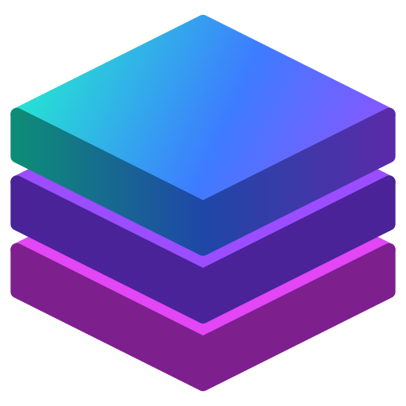

# Cache

Round-ups from every Solana trade, invested into xStocks (tokenized stocks), straight into your own wallet.

**[solcache.app](https://solcache.app)** · **[Docs](https://solcache.app/docs)**

> **Mainnet test of unaudited software.** Use a wallet with only a small amount in it. xStocks are not available to US persons.

## How it works

| Piece | Where | What it does |
| --- | --- | --- |
| `programs/cache` | Solana mainnet (Anchor) | Holds each user's settings in a vault PDA. The user approves the vault as delegate on their funding account (USDC, or a wrapped-SOL "Cache SOL" account they own). Only the keeper can sweep, and every sweep is checked onchain: weekly cap, the user's own destination account, one of the user's picks, a minimum output, and that only Jupiter swap instructions sit between `begin_sweep` and `end_sweep`. |
| `web/worker` | Cloudflare Worker + D1 | Serves the site, polls Helius every 15 minutes for each user's swaps, records round-ups, and sweeps them daily at 12:00 UTC (or on "Sweep now") through Jupiter. |
| `web/index.html`, `web/app.html` | Cloudflare (static assets) | Landing page and the app: connect wallet, one-signature setup, dashboard. |
| `.github/workflows/deploy.yml` | GitHub Actions | Builds and deploys everything. No local tools needed. |

## Repository secrets (Settings → Secrets and variables → Actions)

| Secret | Where to get it |
| --- | --- |
| `DEPLOYER_PRIVATE_KEY` | A fresh Phantom account → Settings → Manage accounts → Show private key. This wallet pays program rent and becomes the program's upgrade authority and admin. |
| `HELIUS_API_KEY` | dashboard.helius.dev → API keys |
| `CLOUDFLARE_API_TOKEN` | dash.cloudflare.com → My Profile → API Tokens → "Edit Cloudflare Workers" template, plus D1 Edit permission |
| `CLOUDFLARE_ACCOUNT_ID` | dash.cloudflare.com → Workers & Pages → Account ID in the right sidebar |
| `JUPITER_API_KEY` (optional) | portal.jup.ag. Without it the worker uses Jupiter's free lite API. |

## Deploying

1. Add the secrets above.
2. Actions → **Deploy Cache** → Run workflow. The first run stops at "Check deployer has enough SOL" and prints the exact amount to send to the deployer address.
3. Fund the deployer, re-run. The run deploys the program, deploys the site and keeper, creates the keeper wallet, initializes the program config and sends the keeper 0.03 SOL for fees.
4. The run summary shows the live link (`https://cache.<your-subdomain>.workers.dev`).

Every later push to `main` redeploys the site; the program only redeploys when its code changes.

## Ops

- `GET /api/health`: keeper address, keeper SOL balance, user count, recent errors.
- Pause everything: call `update_config` with `paused: true` from the admin wallet.
- Close the program and recover its rent: `solana program close <PROGRAM_ID> --bypass-warning` from the deployer wallet.
